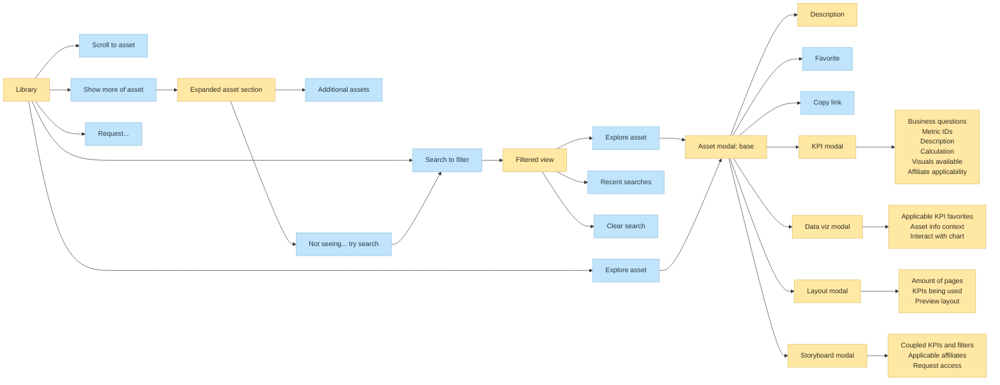

# Take Home for Senior UI Developer

This document transcribes the brief, user goals, and Library wireframe shown in the supplied image.

## Time and deliverables

- **Duration:** 2–3 days from the date sent.
- **Timebox:** 2–3 hours. If you go over, explain why.
- **Deliverables:** a StackBlitz or CodeSandbox link and a Loom link.

## Instructions in the brief

1. Create a StackBlitz or CodeSandbox. Do not mention the company name or that this is a take-home exercise.
2. Use the flow and wireframe to develop the feature with Next.js and Tailwind. Comment thoroughly.
3. Record a 3–5 minute Loom with your camera and screen on, talking through your work. Do not exceed five minutes.
4. Be prepared to discuss the work live on the next call.

## Notes in the brief

- The directional details and high-level requirements are intentionally ambiguous to reflect real-world work.
- Document questions while keeping yourself unblocked.
- Aim to stay very close to the wireframe; pixel perfection is not required.
- Document assumptions and be prepared to explain them.
- Document any improvements you add.
- The brief says not to use GPT for solutioning; it says this would remove a candidate from qualification, though internal use after hiring is acceptable.
- Do not use UI libraries; styling libraries are allowed.
- For questions, the brief says to email Darryl.

## User goals

1. When deciding which KPIs to track, a user needs to see all KPIs for their area and the available chart types so they can build a layout.
2. When diving into KPI data, a user needs to select visuals that communicate insights so they can quickly capture, annotate, and share those insights.
3. When a user lacks access to an asset, they need to request access and give a reason so they can add it to their layouts.

## Terms used in the wireframe

| Term       | Meaning in the image                              |
| ---------- | ------------------------------------------------- |
| KPI        | A calculation based on selected data.             |
| Layout     | A dashboard of visuals or charts.                 |
| Data viz   | A visual representation of data, such as a chart. |
| Storyboard | A PowerPoint-style presentation for charts.       |
| Asset      | Collective name for the above items.              |
| Affiliate  | A subsidiary of the company.                      |

## Library screen and interaction flow

The Library screen is titled **Library**, with the subtitle “Browse for assets needed to report and present analysis.” The mockup shows a search field, tabs for **Featured**, **KPI**, **Layouts**, and **Storyboards**, a **Request** button, and asset cards under **Featured** (“Curated top picks from this week”) and **Trending** (“Most popular by community”).

| Starting point     | Behavior or destination shown in the flow                                                                                                     |
| ------------------ | --------------------------------------------------------------------------------------------------------------------------------------------- |
| Search to filter   | Open a filtered view with recent searches, a clear-search action, and an explore-asset action. Exploring an asset opens the base asset modal. |
| Explore asset      | Open the base asset modal.                                                                                                                    |
| Scroll to asset    | An available Library action; the diagram does not specify a further destination.                                                              |
| Show more of asset | Expand the asset section to show additional assets and a “Not seeing... try search” prompt that leads back to search.                         |
| Request...         | An available Library action for requesting access.                                                                                            |

### Base asset modal

The base modal shows an asset description and actions to **Favorite** or **Copy link**. It branches to a detail modal for the asset type:

| Asset type | Information and actions shown                                                                             |
| ---------- | --------------------------------------------------------------------------------------------------------- |
| KPI        | Business questions, metric IDs, description, calculation, available visuals, and affiliate applicability. |
| Data viz   | Applicable KPI favorites, asset information and context, and an interactive chart.                        |
| Layout     | Number of pages, KPIs used, and a layout preview.                                                         |
| Storyboard | Coupled KPIs and filters, applicable affiliates, and a request-access action.                             |

The second mockup shows an example **Layout** modal over the Library screen. It includes a title and description, tags, usage and page counts, last-updated information, a large preview area, business questions, and a **Favorite item** action.
